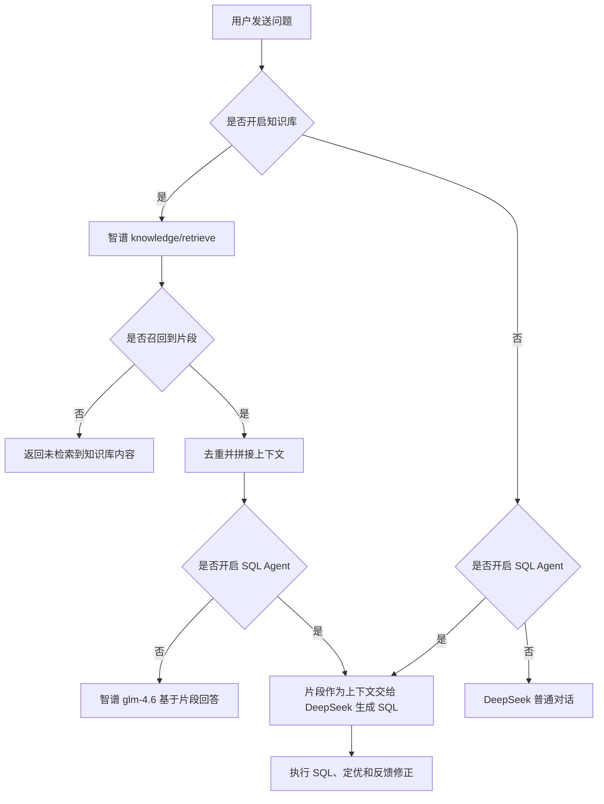

# SQL Agent 知识库 RAG 技术文档

> 适用代码：当前 `fix/chat-history-contract` 分支  
> 最后验证：2026-10-20  
> 状态：显式知识库检索、基于召回片段回答、知识库与 SQL Agent 协同均已实现

## 1. 背景

项目最初通过智谱对话接口的 `tools.retrieval` 参数调用知识库。实际运行中发现，该调用方式可能只返回模型自身的通用回答，并未把知识库片段注入模型上下文。典型现象是：

- 用户询问“刘宇飞是谁？”，页面虽然显示 `RAG` 标记，但回答是通用常识；
- 对话接口返回的 `prompt_tokens` 只有 10，说明请求中没有带入知识库文档；
- 直接调用知识库检索接口时，却能准确召回“刘宇飞高中在新余一中读书”等片段。

因此，当前实现改为确定性的两阶段 RAG：

1. 显式调用智谱知识库检索接口，获取真实文档片段；
2. 根据当前模式，把片段交给智谱生成回答，或交给 DeepSeek 生成 SQL。

这种方式不依赖对话模型是否主动调用检索工具，调用链清晰，召回结果和失败原因也更容易检查。

## 2. 问题发现过程

### 2.1 预期行为与实际行为

测试问题：

```text
刘宇飞是谁？
```

知识库中已经存在以下内容：

```text
刘宇飞高中在新余一中读书
```

预期回答应包含：

```text
刘宇飞是新余一中的学生，同时是南昌大学的在读本科生。
```

实际现象：

- 页面显示了 `RAG` 标记；
- 接口返回 HTTP 200；
- 回答却是“刘宇飞是一个常见名字，可能指医生、官员或企业人士”等模型自身常识；
- 回答没有出现“新余一中”，说明知识库片段没有被模型使用。

这说明问题既不是接口不可达，也不是页面没有发送请求，而是“知识库检索结果没有真正进入回答模型”。

### 2.2 排查过程

| 排查步骤 | 观察结果 | 结论 |
| --- | --- | --- |
| 检查知识库 ID | `knowledgeId=1906275880188198912`，对应 `test` 知识库 | ID 存在且配置正确 |
| 检查知识库文档列表 | 文档数量为 12，`embedding_stat=1` | 文档已上传并完成向量化 |
| 检查对话请求体 | 包含 `tools.retrieval`、正确的 `knowledge_id` 和模型 `glm-4.6` | 旧请求字段符合官方示例 |
| 独立调用知识库检索接口 | 成功召回“刘宇飞高中在新余一中读书”等片段 | 知识库内容和检索服务正常 |
| 对比对话响应用量 | `prompt_tokens=10`，仅包含用户问题 | 文档片段没有进入对话上下文 |
| 检查旧业务判断 | 只要 `choices[0].message.content` 非空就标记 RAG | 通用回答被误判为知识库回答 |

### 2.3 关键证据

旧实现的日志中可以看到：

```text
knowledgeId=1906275880188198912
query=刘宇飞是谁？
model=glm-4.6
```

但对话响应的关键用量是：

```json
{
  "usage": {
    "prompt_tokens": 10
  }
}
```

如果知识库片段被注入，`prompt_tokens` 通常会显著增加。只有 10 个 token，基本等于只发送了用户问题本身。这是“检索没有真正发生”或“检索结果没有注入模型”的直接证据。

与此同时，直接调用知识库检索接口返回了真实片段，其中最高相关片段是：

```text
刘宇飞 男 南昌大学在读本科生
```

还有一条命中：

```text
李芳辉 男 20岁 南昌大学 计算机大数据专业本科生
刘宇飞高中在新余一中读书
```

因此，问题不在文档内容，也不在知识库 ID，而在旧的调用方式与结果判断逻辑。

### 2.4 问题结论

旧实现存在两个叠加问题：

1. 对话接口的 `tools.retrieval` 在当前模型和账号组合下没有把文档注入回答上下文；
2. 业务代码没有验证“是否真的召回了文档”，而是把任何非空模型回复都标记成 RAG。

第二个问题让第一个问题变得非常隐蔽：即使检索完全没执行，页面仍会显示 `RAG`，用户只能从答案内容判断异常。

## 3. 原因分析与方案思考

### 3.1 官方资料与 Java 接入缺口

项目开发过程中遇到的一个实际问题是：智谱官网的知识库调用示例主要提供 Python 代码，包括：

```python
response = client.chat.completions.create(
    model="glm-4.6",
    messages=[{"role": "user", "content": "用户问题"}],
    tools=[
        {
            "type": "retrieval",
            "retrieval": {
                "knowledge_id": "your knowledge id",
                "prompt_template": "从文档...回答问题"
            }
        }
    ]
)
```

当前项目是 Java/Spring Boot 技术栈，不能直接照搬 Python SDK。检查项目已有的智谱 Java SDK `oapi-java-sdk:1.0.6` 后，也没有发现可直接使用的知识库检索客户端类。

这不代表 Java 无法接入，而是意味着需要根据官方 OpenAPI/HTTP 定义自行封装请求。后续排查中确认知识库检索本身有独立的 HTTP 接口：

```http
POST https://open.bigmodel.cn/api/llm-application/open/knowledge/retrieve
```

因此可以采用 Java 原生的 `RestTemplate` 发送 JSON，并使用 Jackson 解析响应，不需要额外部署 Python 服务。

### 3.2 旧方法为什么不行

旧流程是：

```text
用户问题
  -> 智谱对话接口
  -> tools.retrieval
  -> 期望模型自动检索知识库
  -> 模型返回最终回答
  -> 旧代码只要 content 非空就标记 fromKnowledgeBase=true
```

该方案存在以下问题：

1. **检索是否执行不透明**  
   `tools.retrieval` 是一次对话调用中的模型工具编排，业务代码无法直接判断模型是否真的调用了检索工具，也无法获得明确的召回片段和分数。

2. **当前模型/账号组合可能跳过检索**  
   在本次实际调用中，请求返回成功，但 `prompt_tokens=10`，知识库内容没有进入上下文。只调整提示词无法强制模型使用未注入的文档。

3. **旧提示词允许使用模型自身知识兜底**  
   原提示词包含“找不到答案就用自身知识回答”。这会让检索失败时仍然生成一段看似合理的回答，掩盖真实故障。

4. **业务代码误判 RAG 成功**  
   旧代码把 `choices[0].message.content` 非空视为知识库回答。实际上该字段只代表“模型返回了文本”，不能证明任何文档被召回。

5. **没有可验证的检索结果对象**  
   旧代码没有检查 `data[]`、文档名、片段数量和相关分数，因此无法区分“没有命中”“接口失败”和“模型自己回答”三种完全不同的情况。

6. **Python 示例无法直接迁移到 Java**  
   官方知识库示例偏向 Python SDK，Java 项目照搬思路时容易继续依赖对话工具调用，却没有先验证知识库检索接口是否能独立工作。

### 3.3 方案对比

| 方案 | 优点 | 问题 | 结论 |
| --- | --- | --- | --- |
| 继续使用 `tools.retrieval`，只修改提示词 | 改动最小 | 无法保证检索真正执行，仍可能把模型常识当成 RAG 回答 | 放弃 |
| 增加 Python 服务，调用官方 Python SDK | 可以直接复用示例 | 多一套运行时、进程和接口，部署与排错成本增加 | 不需要 |
| 只依赖现有 Java SDK | 保持 Java 技术栈 | 当前 SDK 未提供可用的知识库检索客户端 | 不满足需求 |
| Java 直接调用智谱 HTTP 检索接口 | 不依赖额外语言；检索结果可见；可测试、可报错 | 需要自行封装请求和解析响应 | 最终采用 |
| 自建向量数据库并本地检索 | 控制力强 | 需要同步文档、维护索引和嵌入模型，超出当前项目范围 | 暂不采用 |

### 3.4 最终方案与思考

最终没有继续猜测提示词，而是把问题拆成两个可独立验证的步骤：

1. **先只验证检索**：使用 Java 直接调用 `knowledge/retrieve`，确认能否返回目标片段；
2. **再验证生成**：把已召回的片段显式放入系统上下文，让智谱只能依据片段回答。

这种拆分带来以下好处：

- 检索失败和生成失败可以分别定位；
- 可以用 `data[]`、`sourceCount` 和相关性分数证明召回确实发生；
- 没有命中时不会调用回答模型，也不会显示 RAG；
- 召回的上下文可以直接用于 SQL Agent；
- Java 项目不需要引入 Python 运行时；
- 每个环节都可以用单元测试和固定响应验证。

最终验证时，先通过 Java HTTP 请求召回了“刘宇飞高中在新余一中读书”，再把片段交给 `glm-4.6`，得到包含“新余一中”的回答，证明“显式检索 + 受约束生成”的链路有效。

## 4. 总体流程



主要组件：

| 组件 | 职责 |
| --- | --- |
| `KnowledgeBaseService` | 调用智谱知识库检索接口；清理、去重、拼接片段；调用智谱生成 RAG 回答 |
| `SQLAgentService` | 决定知识库和 SQL Agent 的执行分支；协调 SQL 生成、执行和反馈修正 |
| `DeepSeekService` | 普通对话、SQL 生成、SQL 修复 |
| `ChatService` | 保存用户消息、助手消息和知识库来源标记 |
| `ChatController` | 提供 `/api/chat/send` 和 `/api/chat/history/{sessionId}` 接口 |

## 5. 由哪个 AI 回答

这是当前实现中最容易混淆的部分。知识库检索和回答生成不一定由同一个模型完成。

| 模式 | 处理方式 |
| --- | --- |
| 只开启知识库 | 智谱检索片段，再由智谱 `glm-4.6` 基于片段回答，不走 DeepSeek |
| 同时开启知识库和 SQL Agent | 智谱负责召回片段，片段作为上下文交给 DeepSeek 生成 SQL |
| 只开启 SQL Agent | 不调用知识库，DeepSeek 直接生成 SQL |
| 两个开关都关闭 | DeepSeek 进行普通对话 |

更具体地说：

- 普通 RAG 问答的检索入口是 `KnowledgeBaseService.retrieve()`；
- 普通 RAG 问答的回答生成入口是 `KnowledgeBaseService.answer()`；
- `answer()` 使用配置中的 `zhipu.api-url` 和 `zhipu.model`，因此调用的是智谱，不是 DeepSeek；
- DeepSeek 只在 SQL Agent 分支负责生成和修正 SQL；
- SQL Agent 的最终回复由 `SQLAgentService.generateReplyFromResults()` 根据 SQL 执行结果格式化，不再调用大模型总结。

对应代码：

- [KnowledgeBaseService.java:66](src/main/java/com/example/sqlagent/agent/KnowledgeBaseService.java:66)：知识库检索；
- [KnowledgeBaseService.java:127](src/main/java/com/example/sqlagent/agent/KnowledgeBaseService.java:127)：智谱基于片段回答；
- [SQLAgentService.java:61](src/main/java/com/example/sqlagent/agent/SQLAgentService.java:61)：调用知识库检索；
- [SQLAgentService.java:89](src/main/java/com/example/sqlagent/agent/SQLAgentService.java:89)：只开启知识库时的回答；
- [SQLAgentService.java:125](src/main/java/com/example/sqlagent/agent/SQLAgentService.java:125)：把知识库上下文交给 DeepSeek 生成 SQL。

## 6. 只开启知识库

调用链：

```text
前端 useKnowledgeBase=true
  -> POST /api/chat/send
  -> ChatService.sendMessage()
  -> SQLAgentService.processChat()
  -> KnowledgeBaseService.retrieve()
       -> POST 智谱 knowledge/retrieve
       -> 获取 data[]
       -> 去重
       -> 拼接上下文
  -> KnowledgeBaseService.answer()
       -> POST 智谱 chat/completions
       -> glm-4.6 仅依据片段生成回答
  -> ChatResponse.fromKnowledgeBase=true
```

关键行为：

1. 只有检索接口实际返回至少一个有效片段时，才把 `fromKnowledgeBase` 设为 `true`。
2. 没有召回内容时，不调用回答模型，直接返回“知识库中未检索到与问题相关的内容。”
3. 检索接口报错时，不把模型自身回答伪装成 RAG 结果，返回明确的错误信息。
4. 回答生成失败时，`fromKnowledgeBase` 会被重新设为 `false`，避免页面误显示 `RAG` 标记。

## 7. 同时开启知识库和 SQL Agent

调用链：

```text
前端 useKnowledgeBase=true, useSqlAgent=true
  -> SQLAgentService.processChat()
  -> 智谱 knowledge/retrieve
  -> KnowledgeBaseResult.context
  -> SQLAgentService.processSQLQuery()
  -> DeepSeekService.generateSQL(..., kbResult=context)
  -> 生成 vote-count 个候选 SQL
  -> 执行候选 SQL 并定优
  -> 失败时进入 Agent 反馈修正
  -> 根据 SQL 执行结果生成最终回复
```

与纯 RAG 模式的区别：

- 智谱不负责生成最终自然语言答案，只负责召回知识库片段；
- 片段会作为 SQL 生成提示词中的“知识库参考信息”；
- DeepSeek 使用这些片段理解业务背景、字段含义和用户问题；
- 最终回复来自 SQL 查询结果，而不是智谱对片段的总结。

因此，“知识库 + SQL Agent”不是两次 RAG 回答，而是：

```text
智谱负责“查资料”，DeepSeek 负责“写 SQL”，业务代码负责“展示结果”
```

## 8. 知识库检索的实现

### 8.1 检索请求

当前代码显式调用：

```http
POST https://open.bigmodel.cn/api/llm-application/open/knowledge/retrieve
Authorization: Bearer <ZHIPU_API_KEY>
Content-Type: application/json
```

实际请求体结构如下：

```json
{
  "request_id": "随机 UUID",
  "query": "刘宇飞是谁？",
  "knowledge_ids": ["1906275880188198912"],
  "top_k": 5,
  "top_n": 20,
  "recall_method": "mixed",
  "rerank_status": 0
}
```

### 8.2 检索参数

| 参数 | 当前值 | 含义 |
| --- | --- | --- |
| `request_id` | 运行时 UUID | 单次请求标识，用于定位日志和排查问题 |
| `query` | 用户原始问题 | 知识库检索语句，接口限制在 1000 字以内 |
| `knowledge_ids` | `[zhipu.knowledge-base-id]` | 要检索的知识库 ID 列表；当前只配置一个知识库 |
| `top_k` | `5` | 最终返回给业务的片段数量，范围 1～20 |
| `top_n` | `20` | 初始召回的候选数量，范围 1～100 |
| `recall_method` | `mixed` | 检索方式，支持 `embedding`、`keyword`、`mixed` |
| `rerank_status` | `0` | 是否启用额外重排；0 表示不启用，1 表示启用 |

检索方式说明：

| 取值 | 含义 | 适用场景 |
| --- | --- | --- |
| `embedding` | 向量语义检索 | 问题与文档用词不同，但语义相近 |
| `keyword` | 关键词检索 | 姓名、编号、型号、专有名词等精确匹配 |
| `mixed` | 向量与关键词混合检索 | 通用推荐方式，兼顾语义和精确词 |

`mixed` 并不代表把所有文档交给大模型，而是由智谱的检索服务先完成候选召回和相关性排序。

### 8.3 片段数 `sourceCount` 的来源

日志：

```text
知识库召回完成: knowledgeId=..., sourceCount=..., contextLength=...
```

其中：

- `sourceCount` 是检索响应 `data[]` 中有效片段去重后的数量；
- 它不是知识库的文档总数，也不是切片的索引总数；
- 受 `top_k=5` 限制，正常情况下最多为 5；
- 如果智谱返回的片段少于 5 个，`sourceCount` 就是实际数量；
- 如果不同文档返回完全相同的 `text`，代码会去重，因此数量可能进一步减少；
- 没有任何命中时，`sourceCount` 不会出现，因为代码直接返回空结果。

`contextLength` 是拼接后的上下文字符数，不是 token 数。

### 8.4 片段上下文

检索结果中的每个片段大致包含：

```json
{
  "text": "李芳辉 男 20岁 南昌大学 计算机大数据专业本科生\n刘宇飞高中在新余一中读书",
  "score": 0.75,
  "metadata": {
    "doc_name": "新建 DOCX 文档.docx",
    "doc_id": "1910134850543882240",
    "knowledge_id": "1906275880188198912"
  }
}
```

当前实现只使用：

- `text`：片段正文；
- `score`：智谱给出的相关性分数，保留在结果对象中用于观察；
- `metadata.doc_name`：文档名称，用于给模型标明片段来源。

不把临时的 `doc_url` 放入上下文，因为该 URL 是带签名和有效期的临时地址。

最终交给模型的上下文格式如下：

```text
【片段 1｜文档：新建 DOCX 文档.docx】
刘宇飞 男 南昌大学在读本科生

【片段 2｜文档：新建 DOCX 文档.docx】
刘宇飞和吴恩泽是南昌大学的学生

【片段 3｜文档：新建 DOCX 文档.docx】
李芳辉 男 20岁 南昌大学 计算机大数据专业本科生
刘宇飞高中在新余一中读书
```

上下文总长度上限为 15,000 个字符。如果命中的片段非常长，超出部分会被截断后再发给回答模型。

## 9. 回答生成

纯知识库模式下，`KnowledgeBaseService.answer()` 会调用：

```http
POST https://open.bigmodel.cn/api/paas/v4/chat/completions
```

回答请求参数：

| 参数 | 当前值 | 含义 |
| --- | --- | --- |
| `model` | `glm-4.6` | 负责基于片段生成自然语言回答的智谱模型 |
| `temperature` | `0.1` | 低温度，减少自由发挥，优先忠实于上下文 |
| `max_tokens` | `1024` | 单次回答的最大生成长度 |
| `stream` | `false` | 当前使用非流式响应，拿到完整结果后一次性返回 |

系统提示词明确要求：

1. 必须且只能依据给定的知识库片段回答；
2. 只使用片段中出现的事实，不补充外部常识，不编造；
3. 片段不足时说明“知识库中未找到足够信息”；
4. 直接回答用户问题，不复述检索过程。

实际验证查询：

```text
用户：刘宇飞是谁？
召回：刘宇飞是南昌大学学生；刘宇飞高中在新余一中读书
回答：刘宇飞是一名男性，南昌大学的在读本科生，他高中在新余一中读书。
```

## 10. 配置参数说明

以下配置位于 `src/main/resources/application.yml`。

### 10.1 智谱知识库配置

| 配置项 | 当前值示例 | 含义 |
| --- | --- | --- |
| `zhipu.api-key` | 不写入文档 | 智谱开放平台 API Key，用于检索和回答接口的 Bearer 认证 |
| `zhipu.knowledge-base-id` | `1906275880188198912` | 当前使用的 `test` 知识库 ID；检索时放入 `knowledge_ids` |
| `zhipu.retrieval-url` | `https://open.bigmodel.cn/api/llm-application/open/knowledge/retrieve` | 知识库召回接口，只负责返回片段 |
| `zhipu.api-url` | `https://open.bigmodel.cn/api/paas/v4/chat/completions` | 智谱对话接口，负责基于片段生成 RAG 回答 |
| `zhipu.model` | `glm-4.6` | 智谱回答生成模型 |
| `zhipu.top-k` | `5` | 最终返回的相关片段上限 |
| `zhipu.top-n` | `20` | 初始候选片段上限 |
| `zhipu.recall-method` | `mixed` | 向量、关键词或混合检索 |

注意事项：

- `retrieval-url` 和 `api-url` 是两个不同接口，不能互换；
- 修改知识库时只需要更换 `knowledge-base-id`，前提是新知识库中的文档已经完成解析和向量化；
- `api-key` 当前写在配置文件中，正式部署应改为环境变量或外部密钥管理，不能提交到公开仓库；
- 如果检索接口返回空结果，应先检查知识库 ID、文档向量化状态和具体问题，而不是直接更换回答模型。

### 10.2 DeepSeek 配置

| 配置项 | 当前值示例 | 含义 |
| --- | --- | --- |
| `deepseek.api-key` | 不写入文档 | DeepSeek API Key |
| `deepseek.api-url` | `https://api.deepseek.com/v1/chat/completions` | DeepSeek 对话接口 |
| `deepseek.model` | `deepseek-v4-flash` | 用于普通对话和 SQL Agent 的模型 |

DeepSeek 不参与纯 RAG 回答生成。它只在这些场景使用：

- SQL Agent 生成候选 SQL；
- SQL 执行失败后的修复；
- 未开启知识库时的普通对话。

### 10.3 SQL Agent 配置

| 配置项 | 当前值 | 含义 |
| --- | --- | --- |
| `sql-agent.vote-count` | `10` | 每次问题生成多少个候选 SQL 进行执行和定优 |
| `sql-agent.temperature` | `0.8` | 候选 SQL 生成的温度，较高温度用于增加多样性 |
| `sql-agent.max-retry-times` | `3` | 所有候选 SQL 都失败后，最多进行多少轮反馈修正 |

SQL 修复时使用较低温度 `0.3`，以减少随机性，该值目前写在 `DeepSeekService` 中。

### 10.4 容易误解的配置

`schema.strategy: knowledge-base` 当前没有被 Java 业务代码读取，不会改变知识库检索策略。当前有效的知识库行为由 `zhipu.*` 和 `SQLAgentService` 中的分支共同决定。

`logging.level.com.example.sqlagent.agent.KnowledgeBaseService: DEBUG` 用于输出知识库服务的调试日志。当前检索和回答的主日志使用 INFO 级别，不需要依赖 DEBUG 才能看到召回数量。

## 11. 性能与规模

### 11.1 不会把整个知识库交给大模型

无论知识库中有 12 个文档还是上千个文档，纯 RAG 问答最终交给回答模型的都只是：

- 最多 `top_k=5` 个片段；
- 拼接后最多 15,000 个字符的上下文。

智谱先执行混合检索，从知识库中筛选候选，再返回最终片段。因此不存在“逐个文档阅读”或“把所有文档塞进 prompt”的过程。

### 11.2 两次模型调用的耗时

纯知识库模式包含两个网络请求：

1. 知识库检索请求；
2. 智谱回答生成请求。

检索通常比生成快。实际测试中，直连检索约 1 秒内返回；回答生成约 9 秒，主要耗时来自大模型生成。文档数量增加会提高知识库建索引、管理和检索侧的资源消耗，但不会线性增加每次提交给回答模型的 token。

### 11.3 `top_n` 与 `top_k` 的调优

- `top_n` 控制初始候选池；
- `top_k` 控制最终送入模型的片段数；
- 默认 `top_n=20`、`top_k=5`，适合当前小规模知识库；
- 增大 `top_k` 可能提高召回率，但也会增加上下文 token、回答延迟和无关信息干扰；
- 如果问题经常需要跨多个文档综合，可适当提高到 6～8；
- 如果问题大多是小事实问答，保持 3～5 通常更稳定。

### 11.4 重排

当前请求使用：

```text
rerank_status = 0
```

表示没有额外启用重排模型。智谱仍会执行混合检索和相关性排序，但不会再进行独立的重排阶段。

如果后续发现：

- 相似片段很多，但真正准确的片段没有排在前几条；
- 专有名词、姓名或业务术语经常被语义相近的内容干扰；
- 增大 `top_k` 后回答反而变差；

可以考虑启用重排：

```json
{
  "rerank_status": 1,
  "rerank_model": "rerank"
}
```

可选模型为 `rerank` 和 `rerank-pro`。启用后通常能提高排序质量，但会增加检索延迟和调用成本，建议通过真实问题集对比后再决定。

当前 `rerank_status` 在 `KnowledgeBaseService.retrieve()` 中固定为 0。如果希望在生产环境灵活切换，建议增加 `zhipu.rerank-status` 和 `zhipu.rerank-model` 配置项。

## 12. 错误处理与可观测性

| 场景 | 当前行为 |
| --- | --- |
| 知识库没有命中 | 不调用回答模型；纯 RAG 模式返回“知识库中未检索到与问题相关的内容。” |
| 检索接口业务码非 200 | 抛出 `KnowledgeBaseException`，响应中写入 `knowledgeBaseError` |
| 检索网络异常 | 同样记录错误，不会把普通回答标记为 RAG |
| 回答生成失败 | 返回明确错误，`fromKnowledgeBase=false` |
| 知识库 + SQL Agent 检索失败 | SQL 流程仍可继续，但缺少知识库上下文 |
| 片段文本重复 | 按 `text` 去重 |
| 上下文过长 | 最多保留 15,000 个字符 |

关键日志：

```text
检索知识库: knowledgeId=..., queryLength=...
知识库召回完成: knowledgeId=..., sourceCount=..., contextLength=...
知识库未召回文档片段: knowledgeId=...
基于知识库片段生成回答: knowledgeId=..., sourceCount=...
知识库回答生成完成: knowledgeId=..., answerLength=...
```

日志不直接输出完整问题和完整知识库内容，避免把用户隐私写进日志。

## 13. 验证结果

使用 `test` 知识库和问题“刘宇飞是谁？”验证，直接检索返回的相关片段包括：

| 相关性分数 | 片段 |
| --- | --- |
| 1.00 | 刘宇飞 男 南昌大学在读本科生 |
| 0.83 | 刘宇飞和吴恩泽是南昌大学的学生 |
| 0.75 | 李芳辉 男 20岁 南昌大学 计算机大数据专业本科生；刘宇飞高中在新余一中读书 |

把这些片段交给 `glm-4.6` 后，回答为：

```text
根据知识库片段，刘宇飞是一名男性，南昌大学的在读本科生，他高中在新余一中读书。
```

单元测试覆盖以下行为：

- 使用正确的知识库检索接口和 `knowledge_ids`；
- `top_k`、`top_n`、检索方式正确写入请求；
- 召回片段会进入回答模型的系统上下文；
- 空结果不会调用回答模型；
- 业务错误不会被静默当成“没有检索结果”。

测试文件：`src/test/java/com/example/sqlagent/agent/KnowledgeBaseServiceTest.java`

运行方式：

```bash
./gradlew test --tests "com.example.sqlagent.agent.KnowledgeBaseServiceTest"
```

## 14. 相关文件

| 文件 | 说明 |
| --- | --- |
| `src/main/java/com/example/sqlagent/agent/KnowledgeBaseService.java` | 检索、上下文拼接、RAG 回答生成 |
| `src/main/java/com/example/sqlagent/agent/KnowledgeBaseResult.java` | 检索结果和来源片段模型 |
| `src/main/java/com/example/sqlagent/agent/SQLAgentService.java` | 知识库与 SQL Agent 分支调度 |
| `src/main/java/com/example/sqlagent/agent/DeepSeekService.java` | 普通对话、SQL 生成和修复 |
| `src/main/java/com/example/sqlagent/dto/ChatResponse.java` | 返回 RAG 标记、知识库上下文和错误信息 |
| `src/main/resources/application.yml` | 智谱、DeepSeek 和 SQL Agent 配置 |
| `src/test/java/com/example/sqlagent/agent/KnowledgeBaseServiceTest.java` | 知识库服务单元测试 |

## 15. 当前限制与后续建议

1. 当前 RAG 回答为非流式，用户需要等待完整回答生成后才会看到结果；可后续改为 SSE 流式输出。
2. 当前只支持一个 `knowledge-base-id`，如需跨知识库检索，可把 `knowledge_ids` 扩展为配置列表。
3. 当前没有把召回的文档名称和分数展示到前端，页面只显示 `RAG` 标记；如需可追溯性，可在响应中增加来源列表。
4. `rerank_status` 目前固定在代码中，建议改为配置项。
5. API Key 和数据库密码目前写在配置文件中，正式部署应迁移到环境变量或密钥管理系统。
